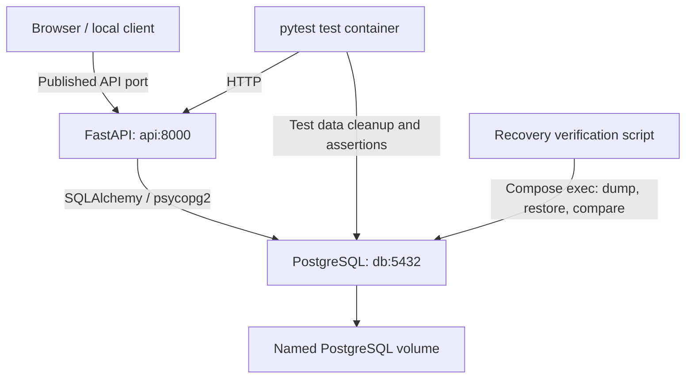

# Staging Recovery Lab

[](https://github.com/taha-khalid/staging-recovery-lab/actions/workflows/ci.yml)

A containerized FastAPI and PostgreSQL lab demonstrating isolated integration testing, verified logical database recovery, and publication of tested images to GitHub Container Registry (GHCR).

The pipeline checks application behavior, restores a real PostgreSQL backup into a separate database, compares restored records, and tests readiness during a database outage. It publishes the same API and test images that passed verification.

## Architecture



- API and test images run as non-root users.
- PostgreSQL is accessible on the Compose network; its port is not published to the host.
- Each Compose project gets its own network and database volume.
- The API uses synchronous SQLAlchemy database operations. Readiness moves its blocking database check to a thread and awaits it with a response deadline.
- PostgreSQL 18 data is mounted at `/var/lib/postgresql`.

## Prerequisites

- Docker Engine or Docker Desktop running Linux containers, with Docker Compose v2.
- Git.
- Python 3.12+ for the host-side recovery script. No host PostgreSQL installation is required.

Commands below use Windows PowerShell. Run them from the repository root. Example credentials are for a disposable local lab only; use a URL-safe password, such as generated hexadecimal characters, because Compose embeds it in a connection URL.

## Repository layout

```text
app/                         FastAPI application and database engine
db/init.sql                  Initial items table schema
tests/test_api.py            HTTP integration tests and database checks
scripts/verify_recovery.py   Backup, restore, and item-data comparison
.github/workflows/ci.yml     Verification and GHCR publication
Dockerfile                   API image
Dockerfile.tests             Test runner image
compose.yaml                 Shared development and test service definitions
requirements.txt             API dependencies
requirements-test.txt        Test image dependencies
.env.example                 Development configuration template
.env.test.example            Test configuration template
```

## Run development locally

```powershell
git clone https://github.com/taha-khalid/staging-recovery-lab.git
cd staging-recovery-lab
Copy-Item .env.example .env
```

Set these values in `.env`:

```dotenv
POSTGRES_USER=appuser
POSTGRES_PASSWORD=local-development-password
POSTGRES_DB=appdb
API_PORT=8000
```

Then build and start:

```powershell
docker compose --env-file .env -p recovery-dev up -d --build --wait api db
curl.exe -i http://127.0.0.1:8000/health
curl.exe -i http://127.0.0.1:8000/ready
```

Interactive API documentation: <http://127.0.0.1:8000/docs>.

The PostgreSQL image creates the configured database and user and runs `db/init.sql` only when its data directory is empty. Changing environment values or the SQL file does not update an already initialized database. The configured `POSTGRES_USER` is a PostgreSQL superuser in this lab.

## API endpoints

| Endpoint | Purpose | Expected success |
| --- | --- | --- |
| `GET /` | Welcome response | 200 |
| `GET /health` | Application responds without a database query | 200 |
| `GET /ready` | Database connection and `SELECT 1` succeed | 200 |
| `POST /items` | Save an item with a string `name` | 201 |
| `GET /items` | List items | 200 |
| `GET /items/{id}` | Retrieve an item | 200, or 404 if absent |

Readiness returns 503 if the database is unavailable or the configured response deadline expires. Invalid item input returns 422. The intended readiness deadline is five seconds; CI permits up to seven seconds for HTTP and scheduling overhead.

Example request body for `POST /items`:

```json
{"name": "recovery-demo"}
```

## Run isolated integration tests

```powershell
Copy-Item .env.test.example .env.test
```

Set `.env.test` to:

```dotenv
POSTGRES_USER=testuser
POSTGRES_PASSWORD=local-test-password
POSTGRES_DB=appdb_test
API_PORT=8001
```

For local builds, leave `API_IMAGE` and `TEST_IMAGE` unset. Replace or comment out any placeholder registry URLs in the template. `DB_PORT` is not used by the current Compose configuration.

```powershell
docker compose --env-file .env.test -p recovery-tests --profile test build api tests
docker compose --env-file .env.test -p recovery-tests up -d --no-build --wait api db
docker compose --env-file .env.test -p recovery-tests --profile test run --rm --no-deps tests
```

The suite contains six cases:

1. Health returns 200.
2. Database readiness returns 200.
3. Creating an item returns 201 and an ID and persists a record.
4. Retrieving an item returns the saved ID and name.
5. Missing `name` returns 422 without inserting a record.
6. A non-string `name` returns 422 without inserting a record.

The readiness fixture waits for API startup. Cleanup truncates the test `items` table before and after each test. Run these tests sequentially and only against the isolated test database, never against development or production data.

## Run published GHCR images

Both published images were pulled and verified locally with all six tests passing. This known verified pair uses the same source commit:

```dotenv
API_IMAGE=ghcr.io/taha-khalid/staging-recovery-api:sha-0c0a3191bf777ee6e7e3d4549c8b527ddeb588a0
TEST_IMAGE=ghcr.io/taha-khalid/staging-recovery-tests:sha-0c0a3191bf777ee6e7e3d4549c8b527ddeb588a0
```

Add those entries to `.env.test`, alongside its database settings, then run:

```powershell
docker compose --env-file .env.test -p recovery-tests --profile test pull api tests
docker compose --env-file .env.test -p recovery-tests up -d --no-build --wait api db
docker compose --env-file .env.test -p recovery-tests --profile test run --rm --no-deps tests
```

Do not use `--build` for this verification. For newer releases, select a matching API/test SHA pair from the workflow summary or [GitHub Packages](https://github.com/taha-khalid?tab=packages). SHA tags identify the source revision but are not registry-enforced immutable references; use image digests when strict content pinning is required.

## Verify backup and restoration

Run after the integration suite finishes, with no other writers using the test database:

```powershell
docker compose --env-file .env.test -p recovery-tests stop api
python scripts/verify_recovery.py --env-file .env.test --project recovery-tests
docker compose --env-file .env.test -p recovery-tests start api
```

The script refuses source databases other than `appdb_test`. It inserts a unique marker, captures item data, creates a custom-format `pg_dump`, restores it into a uniquely named database using `pg_restore`, and compares every item's ID, name, and creation timestamp. It attempts to remove the recovery database and marker afterward.

Outputs:

- `backups/<unique-id>.dump`: logical database backup.
- `reports/recovery.json`: result, item count, backup size, SHA-256, and backup/restore durations.

One observed local run restored one matching record from a 2,340-byte backup, with a backup duration of 0.594 seconds and restore duration of 0.480 seconds. These are small-dataset observations, not production recovery objectives. The SHA-256 identifies backup bytes; restored-data comparison is the recovery assertion.

Keep `backups/`, `reports/`, `.env`, and `.env.test` out of Git. Backups contain database data.

## Verify database outage behavior

Once the restarted API is ready:

```powershell
docker compose --env-file .env.test -p recovery-tests stop db
curl.exe -i --max-time 8 -w "\nTotal time: %{time_total}s\n" http://127.0.0.1:8001/ready
curl.exe -i http://127.0.0.1:8001/health
docker compose --env-file .env.test -p recovery-tests start db
```

Expect `/ready` to return 503 promptly and `/health` to remain 200. After PostgreSQL becomes ready again, `/ready` should return 200. The response deadline stops waiting for the thread-based check; it does not forcibly terminate a blocked database operation.

## CI and image publication

| Event | Integration, recovery, and outage checks | GHCR publishing |
| --- | --- | --- |
| Pull request | Run | Skipped |
| Push to `main` | Run | Runs after successful verification |
| Manual workflow dispatch | Run | Skipped |

Each CI run uses an isolated Compose project. It builds the images, runs pytest, verifies a backup restore, restarts and waits for the API, then checks behavior with PostgreSQL stopped. Diagnostics are collected and cleanup is attempted even after failures.

Artifacts include JUnit results, Compose logs, container status, and `recovery.json` when those stages produce them. Backup dumps are not included in diagnostics. Tested image archives are retained briefly to transfer the builds to a separate publishing job. That job loads and tags those images rather than rebuilding them, authenticates with the temporary `GITHUB_TOKEN`, and publishes `sha-<full-commit-sha>` tags. Registry write permission is limited to the publishing job.

`main` is protected by a pull-request rule requiring the exact check name **Integration tests**. Keep that name stable when editing the workflow.

The current CI configuration uses repository secrets for its test database settings. Those secrets are unavailable to ordinary fork PR workflows, so fork contribution testing requires adapting that configuration, for example by generating disposable test credentials per run. No production credentials are needed for these tests.

## Image-size measurements

Measured locally during development; sizes vary with dependency versions, architecture, and Docker storage accounting.

| Image | Initial measured size | Alpine with `--no-cache-dir --no-compile` | Reduction |
| --- | --- | --- | --- |
| API | 269 MB | 131 MB | About 51% |
| Test runner | 236 MB | About 107 MB | About 55% |

`--no-cache-dir` omits pip's download cache. `--no-compile` skips installation-time Python bytecode generation; it does not disable native-extension compilation. Alpine's smaller base trades off some binary-package compatibility, so functionality was verified with the integration suite.

## Cleanup

Stop and remove test containers and their network, retaining database data:

```powershell
docker compose --env-file .env.test -p recovery-tests down
```

Delete the disposable test database volume as well:

```powershell
docker compose --env-file .env.test -p recovery-tests down --volumes
```

The second command permanently deletes this project's database volume. Development data remains separate when it uses a different Compose project name. Local files in `backups/` and `reports/` are not removed by Compose.

## Troubleshooting

| Symptom | Check |
| --- | --- |
| Public GHCR image pull returns authorization 403 | Run `docker logout ghcr.io` and retry; stale saved credentials caused this during verification. |
| Tests cannot reach API | Use `http://api:8000` inside the test container, not the published host port. |
| Direct psycopg2 connection rejects URL | Use `postgresql://` for tests; `postgresql+psycopg2://` is the API's SQLAlchemy URL. |
| Recovery script refuses source DB | Use `POSTGRES_DB=appdb_test` in the isolated test environment. |
| Initialization SQL changes have no effect | Initialization runs only on an empty data directory; use explicit migrations for existing databases. |
| Required check stays pending | Match the ruleset name exactly to the workflow job name: `Integration tests`. |
| Host API port is occupied | Stop the older API container or change `API_PORT`. |

## Scope and limitations

This lab verifies logical database recovery on the same running PostgreSQL server. It does not demonstrate recovery from total host or volume loss, point-in-time recovery, off-site backup retention, or application traffic against the restored database. Item-data comparison is not a comprehensive assertion of every database object or permission.

The API has no authentication or TLS and the database role has lab-level privileges. Additional work for a production deployment includes least-privilege roles, migrations, persistent encrypted backup storage, retention and scheduling, secret management, monitoring, security scanning, and capacity testing. GHCR publication distributes verified images; deployment to a long-running environment is outside this milestone.
